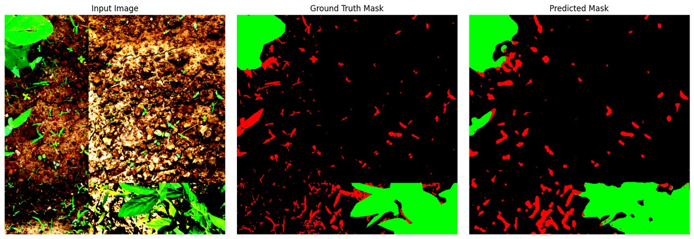
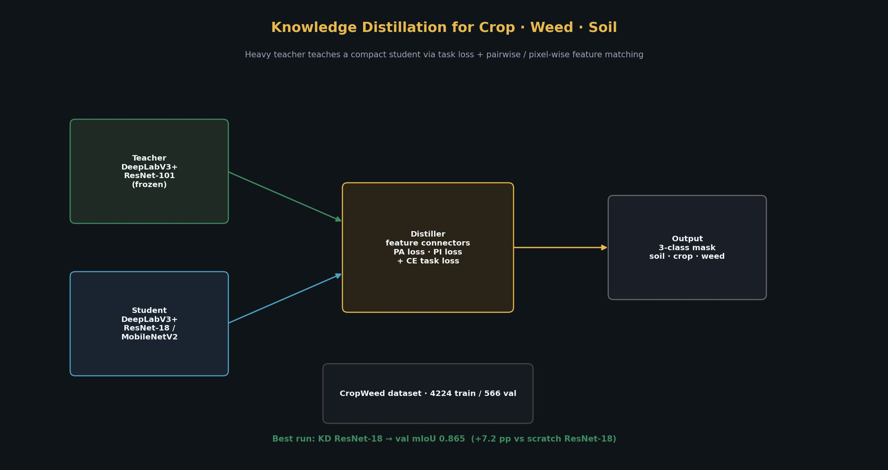
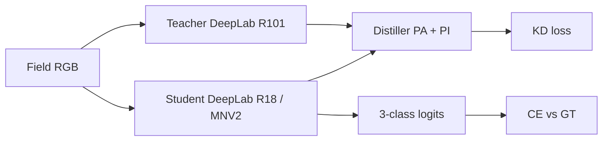
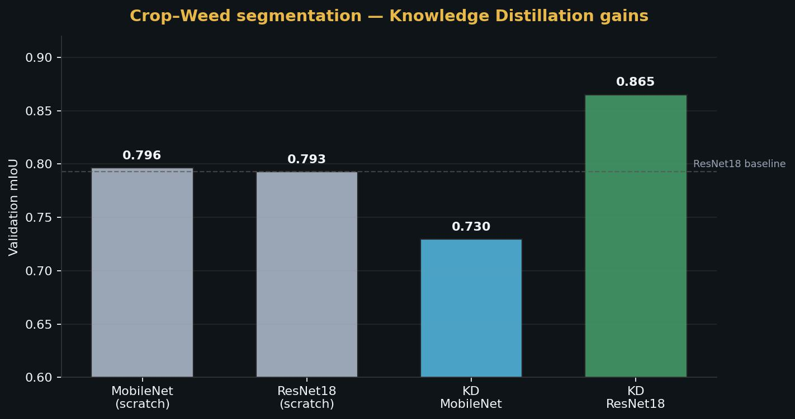
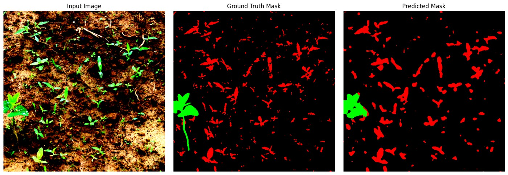

<h1 align="center">CropWeed Knowledge Distillation</h1>

<p align="center">
  <strong>Compress DeepLabV3+ teachers into fast students for soil · crop · weed segmentation.</strong><br>
  Pairwise + pixel-wise distillation on a real UAV / field crop-weed dataset · <b>2025</b>
</p>

<p align="center">
  
  
  
  
  
  
</p>

<p align="center">
  
</p>
<p align="center"><em>Left → right: RGB · ground truth · KD student prediction (crop green · weed red · soil black)</em></p>

---

## Why knowledge distillation?

Field robots need **accurate** crop/weed masks but also **small, fast** models.  
A ResNet-101 DeepLabV3+ teacher is strong but heavy. Distillation transfers its multi-scale feature behaviour into a ResNet-18 / MobileNetV2 student so you keep most of the accuracy at a fraction of the capacity.

> **Timeline:** Research & experiments in **2025** (building on our late-2023 crop–weed U-Net work).

| Class | ID | Color |
|-------|----|-------|
| Soil | 0 | black |
| Crop | 1 | green |
| Weed | 2 | red |

---

## Architecture

<p align="center">
  
</p>

### Distillation losses (`distiller.py`)

| Loss | Role |
|------|------|
| **CE / task loss** | Student matches ground-truth labels |
| **PA (pairwise)** | Match teacher–student affinity structure at mid features |
| **PI (pixel-wise)** | Match normalized spatial energy maps |

Teacher stays **frozen**; only the student + 1×1 feature connectors train.



---

## Results (validation mIoU)

<p align="center">
  
</p>

| Setting | Backbone | Epochs | Crop size | **mIoU** |
|---------|----------|-------:|----------:|---------:|
| Scratch | MobileNetV2 | 30 | 513 | 0.7965 |
| Scratch | ResNet-18 | 30 | 513 | 0.7929 |
| KD | MobileNetV2 | 80 | 513 | 0.7296 |
| **KD (best)** | **ResNet-18** | **150** | **1024** | **0.8652** |

**+7.2 percentage points** over the scratch ResNet-18 student when distilled at 1024² crops.

<p align="center">
  
</p>

Raw experiment notes: [`results/SUMMARY.md`](results/SUMMARY.md).

---

## Project structure

```text
.
├── train.py / train_kd.py   # scratch student · KD trainer
├── distiller.py             # PA / PI feature distillation
├── modeling/                # DeepLabV3+ (ResNet / MobileNet)
├── dataloaders/             # CropWeed dataset + augments
├── utils/                   # losses, metrics, saver, LR
├── configs/                 # example YAML hyper-params
├── sfnet.py                 # optional lightweight SFNet head
├── assets/                  # README figures
└── results/                 # recorded mIoU from best runs
```

---

## Quick start

```bash
git clone https://github.com/Sandesh1764/cropweed-kd.git
cd cropweed-kd
python -m venv .venv && source .venv/bin/activate
pip install -r requirements.txt
```

### 1. Data

Follow [`data/README.md`](data/README.md) (4224 train / 566 val in our split).

```bash
export CROPWEED_ROOT=/path/to/data/cropweed
```

### 2. Teacher weights

Place DeepLabV3+ ResNet-101 weights at:

```text
pretrained/deeplab-resnet101.pth.tar
```

(Compatible with the [pytorch-deeplab-xception](https://github.com/jfzhang95/pytorch-deeplab-xception) release used by the upstream KD code.)

### 3. Train student (no KD)

```bash
CUDA_VISIBLE_DEVICES=0 python train.py \
  --backbone resnet18 --dataset cropweed \
  --epochs 30 --batch-size 4 --lr 0.01 \
  --base-size 513 --crop-size 513
```

### 4. Train with distillation

```bash
CUDA_VISIBLE_DEVICES=0 python train_kd.py \
  --backbone resnet18 --dataset cropweed \
  --epochs 150 --batch-size 4 --lr 0.01 \
  --base-size 1024 --crop-size 1024 \
  --pa-lambda 1.0 --pi-lambda 10.0
```

Checkpoints land under `run/cropweed/...` via the experiment `Saver`.

> **Note:** Full KD training needs a CUDA GPU. This environment packaged the **completed 2025 runs** (metrics + figures) when GPU access was unavailable at publish time.

---

## Method notes

1. Freeze teacher BatchNorm in ASPP global pooling before `DataParallel` (stability fix in `train_kd.py`).
2. Feature connectors (`1×1 Conv + BN`) align student channels to teacher before PA/PI.
3. Higher crop size (1024) helped the best ResNet-18 KD run — thin weed instances benefit from resolution.

---

## Acknowledgements & attribution

This codebase adapts open semantic-segmentation + distillation ideas for **crop/weed**:

- DeepLabV3+ implementation lineage: [pytorch-deeplab-xception](https://github.com/jfzhang95/pytorch-deeplab-xception)
- Distillation structure inspired by open KD segmentation projects ([AICSD](https://github.com/AmirMansurian/AICSD) / related KD forks)
- Dataset task continues our [crop-weed U-Net](https://github.com/Sandesh1764/crop-weed-segmentation) work

If you use this repo, please also cite the original DeepLab and distillation papers appropriate to your experiment.

## License

MIT — see [LICENSE](LICENSE).
